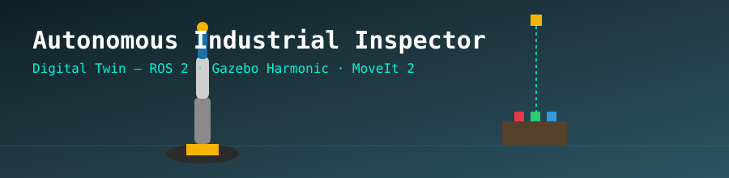
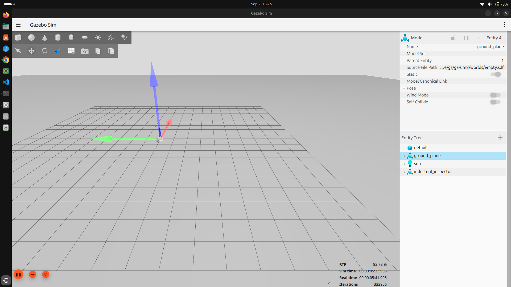
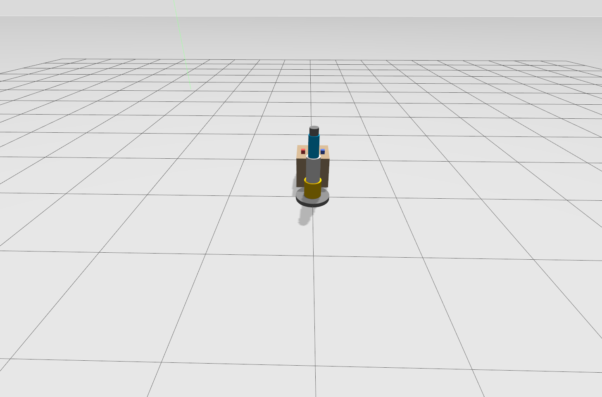
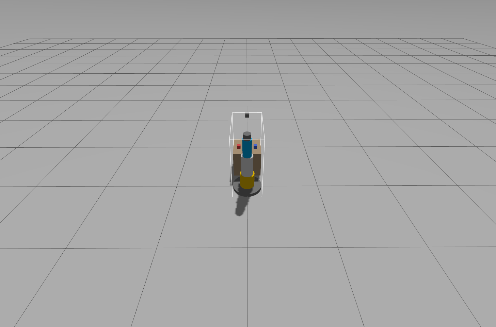
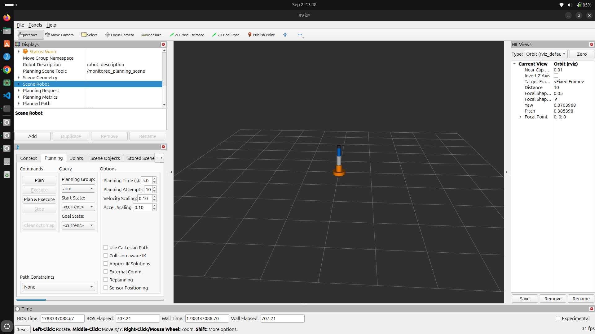

<div align="center">



</div>

An industrial inspection and pick-and-place robotic system built using **ROS 2 Jazzy**, **Gazebo Harmonic**, and **MoveIt 2**.

## Key Features

* **Simulation:** Gazebo Harmonic digital twin of a 4-DOF industrial arm
* **Control:** ros2_control + gz_ros2_control hardware interface, position-controlled joint trajectory controller
* **Motion Planning:** MoveIt 2 (OMPL) collision-free path planning and execution
* **Inspection Environment:** Custom Gazebo world with an inspection table and three colored objects, positioned within the arm's reach
* **Perception:** OpenCV-based color object detection over a fixed overhead camera feed
* **Manipulation:** Parallel-jaw gripper driven by its own `gripper_controller`
* **Pick-and-place:** Camera detection -> MoveIt collision-free transit -> straight-line grasp/lift/place -> cubes sorted onto an output pedestal
* **Architecture:** Modular ROS 2 packages (`inspector_description`, `inspector_bringup`, `inspector_moveit_config`, `inspector_perception`, `inspector_pick_place`)
* **Deployment:** Dockerfile + docker-compose (ROS 2 Jazzy, Gazebo Harmonic, MoveIt 2)

## Screenshots


*Full scene overview in Gazebo Harmonic -the 4-DOF arm, inspection table, and inspection objects.*


*Close-up of the digital twin -base, shoulder, upper arm, forearm, and wrist links.*


*The arm in a commanded pose, reaching toward the inspection table.*


*MoveIt 2 Motion Planning panel in RViz -planning a collision-free trajectory before execution.*

## System Requirements

* **OS:** Ubuntu 24.04 LTS (Noble Numbat)
* **Middleware:** ROS 2 Jazzy Jalisco
* **Simulation:** Gazebo Harmonic
* **Motion Planning:** MoveIt 2

## Quick Start

### 1. Build the workspace

```bash
cd ~/ros2_projects/autonomous-industrial-inspector
colcon build --symlink-install
source install/setup.bash
```

### 2. Launch the full system (Gazebo + ros2_control + MoveIt 2 + RViz)

```bash
ros2 launch inspector_bringup full_system.launch.py
```

This brings up Gazebo Harmonic with the robot spawned, `joint_state_broadcaster` and `arm_controller` active, then `move_group` and RViz with the MotionPlanning panel ready to plan and execute trajectories.

### 3. Gazebo-only bringup (no MoveIt)

```bash
ros2 launch inspector_bringup simulation.launch.py
```

### 4. Camera + perception pipeline

```bash
ros2 launch inspector_perception perception.launch.py
```

Brings up the full simulation plus an overhead camera bridged into ROS 2, with a color-based object detector publishing detections and an annotated debug image on `/camera/detections_image`.

## Current Status & Development Roadmap

* [x] URDF (4-DOF arm) & Gazebo Harmonic digital twin
* [x] ros2_control hardware interface, joint_state_broadcaster + arm_controller
* [x] MoveIt 2 motion planning (OMPL) -plan and execute via RViz
* [x] Inspection environment (table + 3 colored objects in custom Gazebo world)
* [x] Perception pipeline (overhead camera + OpenCV color-based object detection)
* [x] Gripper + automated pick-and-place execution (inspector_pick_place)
* [x] Dockerization (Dockerfile + docker-compose.yml)

## Autonomous pick-and-place

```bash
ros2 launch inspector_bringup pick_and_place.launch.py
ros2 launch inspector_bringup pick_and_place.launch.py pick_order:=blue,red rviz:=false
```

Overhead-camera detection -> MoveIt collision-free transit -> straight-line grasp/lift/place
-> cubes sorted onto the output pedestal. Unit tests:

```bash
cd src/inspector_pick_place && python3 -m pytest -q test
cd src/inspector_perception && python3 -m pytest -q test
```

## Docker

```bash
xhost +local:docker
docker compose up --build        # full autonomous pick-and-place demo
```

Other launch files inside the container:

```bash
docker compose run --rm inspector ros2 launch inspector_bringup full_system.launch.py
```

The first build downloads several GB (ROS 2 Jazzy desktop-full, Gazebo, MoveIt 2).

## Operator app (Angular + .NET)

A small web panel for the person running the cell: live camera view with detected objects,
choose which cubes to sort and in what order, start or stop a run, and see earlier runs.

Install once:

```bash
sudo apt install -y ros-jazzy-rosbridge-suite dotnet-sdk-8.0 nodejs npm
```

Run (two terminals):

```bash
# 1. robot side: simulation, MoveIt, camera, rosbridge, task manager
ros2 launch inspector_bringup inspector_app.launch.py

# 2. web side: builds the UI and serves everything on http://localhost:5000
./app/run.sh
```

For UI work, run the backend with `dotnet run` in `app/backend/InspectorApi` and the UI with
`npm start` in `app/frontend/inspector-ui` (http://localhost:4200, `/api` is proxied to the backend).
The Angular build needs Node 18.19 or newer.

## Author

Nihara Randini - shniharard@gmail.com
